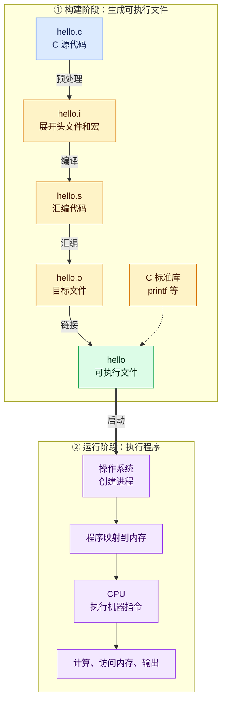

# Lecture 01-Overview
## 1.一个指针例子

e,g,
按执行顺序看：
```C++
int a[3] = {10, 20, 30};
int *p = a;    // 此时 p 指向 a[0]

p++;           // p 向后移动一个 int，指向 a[1]
*p = 99;       // 修改 p 指向的那个元素
```
最终状态：
```text
a:  [10] [99] [30]
          ↑
          p
```

**`sizeof(p)` 不是 `a[0]` 的大小，而是指针变量 `p` 自己占多少字节。 `p` 保存的是一个地址。**

|表达式|测量什么|
|---|---|
|`sizeof(a)`|整个数组占用的字节数|
|`sizeof(p)`|指针变量本身占用的字节数|
|`sizeof(*p)`|`p` 指向的一个 `int` 占用的字节数|
## 2. 核心视角


> [!problem] 核心视角
> 程序里的数据，在机器中是怎样表示的？

所有数据进入内存后 ，以**位（bit）** 保存。一个位只能是0/1.通常8个位组成一个字节

同样的位有不同解释：
比如：01000001

| 规则        | 含义  |
| --------- | --- |
| 无符号二进制整数  | 65  |
| ASCII字符编码 | ‘A' |

> [!abstract] 
> **信息 = 位 + 上下文。**仅知道一串位，还不足以确定它的含义
> 计算机只存储位。类型并不会改变位本身，而是告诉程序如何解释和操作这些位。


## 3. 代码如何运行

> [!problem] 核心问题
> CPU 不能直接执行 C 代码，那么 `hello.c` 是怎样变成运行结果的？



> [!abstract] 核心区别
> **构建阶段**把 C 源代码翻译并组合成可执行文件；  
> **运行阶段**由操作系统创建进程、映射内存，再交给 CPU 执行。


## 4. great reality

**编译负责翻译，操作系统负责加载，CPU 负责执行。**

### 4.1 Ints are not Integers.

```C++
int x = 50000;
int y = x * x;
```
常见32位int 表示：-2,147,483,648 ～ 2,147,483,647
y显然装不下 ，**CPU 没有算错，而是程序选择的 `int` 容器装不下数学结果**

### 4.2 理解汇编

```C
long add(long x, long y)
{
    return x + y;
}
```
编译器转化为类似汇编
```asm
movq %rdi, %rax
addq %rsi, %rax
ret
```
```text
%rdi：保存第一个参数 x
%rsi：保存第二个参数 y
%rax：保存返回值
```
把 `x` 放进返回值位置。
把 `y` 加到其中。
返回调用者，此时 `%rax` 保存 `x + y`。

理解汇编有四个主要用途：
```
理解汇编有四个主要用途：

1. **理解程序出错后的真实行为**
    
    发生越界、指针错误和整数溢出时，高级语言的抽象可能失效，需要查看机器实际执行了什么。
    
2. **分析性能**
    
    判断编译器做了哪些优化，以及程序为什么慢。
    
3. **理解系统软件**
    
    编译器最终生成机器代码；操作系统也需要保存和恢复寄存器等处理器状态。
    
4. **分析安全问题**
    
    缓冲区溢出、恶意代码和逆向分析最终都涉及机器指令。
```

### 4.3 Memory Matters
```C
typedef struct {
    int a[2];
    double d;
} struct_t;
```

它表示一个结构体，存放：
``` C
a[0]、a[1]、d
```

内存排列：
``` text
低地址
┌──────────────┐
│ a[0]：4 字节 │  偏移 0～3
├──────────────┤
│ a[1]：4 字节 │  偏移 4～7
├──────────────┤
│ d：8 字节    │  偏移 8～15
└──────────────┘
高地址
```

```C
double fun(int i)
{
    volatile struct_t s;

    s.d = 3.14;
    s.a[i] = 1073741824;
    return s.d;
}
```

假设
```C++
fun(2)
```
计起只会计算地址：
**a[i]=a 的起始地址 + i × sizeof(int)**

当 `i == 2`：

```
a 的起始地址 + 2 × 4
= 起始地址 + 8
```

而偏移 8 正好已经是 `d` 所在的位置。因此，`s.a[2]` 并不代表真的出现了第三个数组元素；程序只是算出了一个越界地址，并把数据写进了 `d` 的一部分。

```text
┌──────────────┐
│ a[0]         │  i = 0
├──────────────┤
│ a[1]         │  i = 1
├──────────────┤
│ d 的前半部分 │  i = 2，越界
├──────────────┤
│ d 的后半部分 │  i = 3，越界
└──────────────┘
```

这就是 **memory referencing bug**

### 4.4 性能不只取决于复杂度

```C
void copyij(int src[2048][2048],
            int dst[2048][2048])
{
    for (int i = 0; i < 2048; i++)
        for (int j = 0; j < 2048; j++)
            dst[i][j] = src[i][j];
}
```
另一个只交换循环
```C
void copyji(int src[2048][2048],
            int dst[2048][2048])
{
    for (int j = 0; j < 2048; j++)
        for (int i = 0; i < 2048; i++)
            dst[i][j] = src[i][j];
}
```
它们：
- 都复制相同数量的元素
- 都执行大约 $2048^2$ 次赋值
- 时间复杂度都是$O(n^2)$

第二个慢了接近19倍
为什么？
第一个是沿着连续地址读取，第二个不是，它每次都跳过一整行：
**内存系统读取一个 `int` 时，通常会顺便把附近的一整块数据放进高速缓存。按行访问马上就能使用这些相邻数据；按列访问却不断跳到远处，刚取进缓存的数据大多没被利用。**

> [!summary] 总结
> 算法复杂度相同、赋值次数相同，内存访问顺序仍然可以造成巨大的性能差异。


### 4.5 计算机不只是执行程序

计算机必须：
- 把数据读进来、送出去
- 通过网络与其他计算机通信
- 处理多个独立程序同时运行
- 面对不可靠的网络传输
- 处理不同平台之间的兼容问题
I/O 系统会直接影响程序的正确性和性能。

e,g,一个代码怎么执行
```text
hello.c
↓ 编译、汇编、链接
可执行文件 hello
↓ 操作系统创建进程
代码和数据进入内存系统
↓ CPU 执行机器指令
执行 printf
↓ 操作系统处理 I/O
终端显示 hello
```
各自职责是：

- **磁盘**：长期保存 `hello` 可执行文件。
- **内存**：保存运行时可以访问的指令和数据。
- **CPU**：执行机器指令。
- **I/O 设备**：负责输入和输出。
- **操作系统**：创建进程、管理内存、访问磁盘，并协调 I/O。


**所以：一个真实程序不只进行 CPU 计算，还需要与操作系统、存储设备、终端、网络和其他程序交互。**


# Lecture 02-bits,bytes and integers

## 1.bit

一个bit只有两种状态：0/1

计算机不同信息由bit表示，使用两种状态因为电子电路很容易可靠地区分“低电压”和“高电压”。
关键理解：bit本身没有固定意义，具体含义取决于程序如何解释


> [!abstract] 理解
> ```
bits + interpretation = information
>```

## 2.byte

**8个bit组成一个byte**: 一个字节拥有256种bit组合

## 3.为什么使用16进制

二进制很长而十六进制可以更紧凑的表示相同的bit,一位十六进制恰好对应 4 个 bit
比如:
```
10101111=0xAF
```
二进制，十进制，十六进制 只是同一组bit的两种写法而已

## 4.C数据类型的大小

|C 类型|大小|
|---|---|
|`char`|1 byte|
|`short`|2 bytes|
|`int`|4 bytes|
|`long`|8 bytes|
|`float`|4 bytes|
|`double`|8 bytes|
|指针|8 bytes|
`sizeof` 得到的是 **byte 数量**：
```C
sizeof(char)    // 1
sizeof(int)     // 4
sizeof(double)  // 8
```
**指针变量本身的大小与它指向的对象大小不同

比如
```C
int *p=a;
```

```C
sizeof(p)     // 8：地址本身的大小
sizeof(*p)    // 4：p 指向的 int 的大小
```

## 5. 四种基本位运算

### 5.1 单个bit

先只看单个bit

**AND:&**

| A   | B   | `A & B` |
| --- | --- | ------- |
| 0   | 0   | 0       |
| 0   | 1   | 0       |
| 1   | 0   | 0       |
| 1   | 1   | 1       |

**OR:|**
至少一个是 `1`，结果就是 `1`：

| A   | B   | A \| B |     |
| --- | --- | ------ | --- |
| 0   | 0   | 0      |     |
| 0   | 1   | 1      |     |
| 1   | 0   | 1      |     |
| 1   | 1   | 1      |     |
德摩根定律：
$$
A | B = \sim(\sim A \& \sim B)
$$

**XOR:**
两个 bit 不同，结果是 `1`：

| A   | B   | A ^ B |
| --- | --- | ----- |
| 0   | 0   | 0     |
| 0   | 1   | 1     |
| 1   | 0   | 1     |
| 1   | 1   | 0     |
**NOT:~反转**
把每一位反转

### 5.2 整组运算

```
  0110 1001    0x69
& 0101 0101    0x55
-----------
  0100 0001    0x41
```

所以：
```C
0x69 & 0x55    // 结果是 0x41
```

> [!Summary] 总结
> &   筛选：只有掩码为 1 的位置可能保留
>|  设置：把指定位置设为 1
^  切换：指定位置 0/1 互换
~  反转：所有位置 0/1 互换

## 6.移位运算

e.g.
```text
0110 0010 << 3
```
**<<3表示所有 bit 向左移动三格，左边移出去的丢掉，右边补 `0`**。如果我们暂时只看这 8 位，结果是：
```text
0001 0000
```
右移 `>>` 则把右边移出去的 bit 丢掉。区别在于**左边补什么**：
```
原始：       1010 0010
逻辑右移 2： 0010 1000   左边补 0
算术右移 2： 1110 1000   左边重复原来的最高位 1
```
逻辑右移适合把它看作无符号位串；算术右移通常用于保留负数的符号。在 C 中，`unsigned` 右移补 `0`

## 7.有符号数/无符号数

e.g.一个byte
```
128  64  32  16   8   4   2   1
  1   0   1   0   0   0   1   0
```
无符号数：128+32+2=162
有符号数：-128+32+2=-94
**两种计数规则**

## 8.有符号和无符号的转换

位可以不变，但解释出的数值会变。
e.g.
```
bit：       1111 1111
有符号解释：−1
无符号解释：255
```
看C一个结果：
```
-1 < 0     // 真
-1 < 0U    // 假
```
`0U` 后面的 `U` 表示它是 **unsigned（无符号整数）**。第二行比较时，`-1` 和 `0U` 类型不同；在这里，C 会先把 `-1` 转成无符号 `int`。
```
-1 转为 unsigned int → 4294967295
```
于是结果是假。
不是 CPU 把“小于”算错了，而是**比较前发生了隐式类型转换**。

## 9. 窄的整数放进宽的整数

e.g.
一个4位有符号数扩展到8位
```
原来 4 位：        1101       → −3
扩展到 8 位：  1111 1101       → 仍然是 −3
```
当有符号数是负数，为了保持数值不变，新添的高位都复制原来的最高位 `1`。这叫**符号扩展**。
如果补0
```
0000 1101 → +13
```
这是错误的

有符号数为整数，扩展补0：
```
0101 → 0000 0101 → 仍然是 +5
```

## 10.宽的整数放进窄的整数

**把较宽的整数转成较窄的整数**，叫截断。
假设把一个 16 位无符号数放进 8 位空间：
```
原来：0001 0010 0011 0100   （0x1234）
只留低 8 位：0011 0100      （0x34）
```
空间只够 8 位，高位的 `0001 0010` 就被丢掉了。与刚才的扩展不同，**截断可能改变数值**。

# Lecture 03-bits  part2

## 1. 整数运算

### 1.1 无符号加法
e.g.
```
   1101   （13）
 + 0101   （5）
 ------
  10010   （18，需要 5 位）
```
 结果是五位但是只能保存四位 0010 于是变成2 可以理解为$18\%16=2$
 这就是**无符号整数溢出**：和截断一个原因 只可以保留低位


> [!formula] 公式
> $s=UAdd_{u,v}=u+v\mod 2^w$

### 1.2 有符号加法
e.g.
```
   0111   （+7）
 + 0001   （+1）
 ------
   1000
   
```
1000按照补位的规则是-8 数学上7+1=8超过 有符号数的7 出现了**正向溢出（TAdd Overflow）**
## 2.乘法

两个各占$w$位的数 相乘后准确结果最多可能$2w$位
以4位无符号数为例子：
```
7 × 3 = 21
21 的二进制：1 0101   （需要 5 位）
只保留低 4 位： 0101   （结果是5=21%16）
```
**无符号乘法只保留目标宽度能容纳的低位**。

> [!formula] 公式
> $UMult_w(u,v)=u\cdot v \mod 2^w$

## 3. 移位与乘除法

二进制向左移一位 位的权重翻倍
```
0000 0011 = 3
左移 1 位：0000 0110 = 6
左移 2 位：0000 1100 = 12
```
x<<2 相当于乘$2^2=4$ 高位被移出，结果同样可能丢失信息；对 C 的有符号数，不能无条件把左移当作安全的乘法。
**无符号数右移 相当于除以2的幂 丢掉小数部分**
e.g.
```
0000 1101 = 13
右移 2 位：0000 0011 = 3
```

## 4. 无符号的倒序循环问题
 
```C
unsigned i;
for (i = cnt - 2; i >= 0; i--)
    a[i] += a[i + 1];
```

`i` 是无符号数，`i >= 0` 永远成立。走到 `i == 0` 后，`i--` 会回绕到一个非常大的数，于是循环继续。
所以要改用`i < cnt` 判断是否结束：

```C
for (i = cnt - 2; i < cnt; i--)
    a[i] += a[i + 1];
```

## 5. 按字节寻地址的内存

e.g.
假设
```
地址：   100   101   102   103   104 ...
内存：  [  ]  [  ]  [  ]  [  ]  [  ] ...
```
从地址 `0x100` 开始，存放一个 4 字节整数：x = 
0x01234567
每两个高位字节分成一个byte
```
01 | 23 | 45 | 67
```
其中 `01` 是高位字节，`67` 是低位字节。两种字节序决定的是：**哪个字节放在较低的内存地址**。

|地址|`0x100`|`0x101`|`0x102`|`0x103`|
|---|---|---|---|---|
|大端|`01`|`23`|`45`|`67`|
|小端|`67`|`45`|`23`|`01`|

> [!NOTE] Summary
> 这里最重要的区别是：`&x` 给出起始地址；字节序决定从那个地址开始，先看到 `01` 还是 `67`。


## 6. 检查内存的字节顺序

假设
```C
int a=15213;
```
 int 占4字节 补齐后是:
 ```
 0x00003B6D
分成字节：00 | 00 | 3B | 6D
 ```
 如果想每次只看一个字节，可以把 `&a` 暂时当作 `unsigned char *`：
 ```
 unsigned char *p = (unsigned char *)&a;
 ```
如果是字符串:
```
char s[6] = "18213";
```
为什么是6
```
s[0]  '1'   → 0x31
s[1]  '8'   → 0x38
s[2]  '2'   → 0x32
s[3]  '1'   → 0x31
s[4]  '3'   → 0x33
s[5]  '\0'  → 0x00
```
`'\0'` 是**字符串结束标记**，所以数组长度是 6。注意，字符 `'1'` 存的是字符编码 `0x31`，不是整数值 `1`。


# Lecture 04-Floating point

## 1.二进制小数怎么计算

小数点后第一位：1/2；第二位：1/4 第n位：1/2^n

**有限位的二进制小数，只能精确表示分母可写成 `2` 的幂的数**。

## 2. IEEE floating representation

$$
Numerical\ Form=(-1)^s\times M\times 2^E
$$
这里 $s$ 管正负，$M$ 是二进制有效数字，$E$ 管小数点左移动多少位。

## 3. 规格化数（Normalized value）

普通数值，它的位分成
```
s（1 位） | exp（8 位） | frac（23 位）
```

- **`s` 是符号位**：`0` 表示正，`1` 表示负。
- **`exp` 是存起来的指数位**：它决定数值要乘多大的 `2` 的幂，也就是小数点大致移多远。
- `frac` **是有效数字的小数部分**

**32位规则：**

> [!Summary] 规则
> |`Exp`|类型|如何解读|
|---|---|---|
|**1～254**|规格化数|`M = 1.frac₂`，`E = Exp − 127`，数值为 `(-1)^s × M × 2^E`|
|**0**|零或非规格化数|`M = 0.frac₂`，`E = -126`；`frac` 全 0 是 `+0` 或 `-0`，否则是非常接近 0 的数|
|**255**|特殊值|`frac` 全 0 是正/负无穷大；`frac` 非 0 是 NaN|

设指数域有 `k` 位、小数域有 `n` 位，把它们读成整数 `Exp` 和 `frac`。对**规格化数**，通式是:
$$
\begin{align}
&Bias = 2^{k−1} − 1\\
&E    = Exp − Bias\\
&M    = 1 + frac \\
&数值 = (−1)^s \times M \times 2^E\\
\end{align}
$$


e.g.
5.75怎么变为规格化数

```
5.75₁₀ = 101.11₂ = 1.0111₂ × 2²
```
因此：
1. 它是正数，`s = 0`。
2. 小数点左移了 2 位得到 `1.0111₂`，所以实际指数 `E = 2`。
3. 32 位 `float` 的偏移量是 127，因此存储的 `Exp = 2 + 127 = 129`。
4. 开头的 `1` 不存；`frac` 存小数点后的 `0111`，再补零到 23 位。

也就是：
```
s       exp       frac
0   | 10000001 | 01110000000000000000000
```

## 4. 舍入Rounding

### 4.1 保留到整数


> [!Summary] 四种方法
> - **朝零**：`1.6 → 1`，`-1.6 → -1`
>- **朝负无穷**：`1.6 → 1`，`-1.6 → -2`
>- **朝正无穷**：`1.6 → 2`，`-1.6 → -1`
>- **就近，恰好一半时取偶数**：通常选更近的；正好在中间时选偶数。这是常用的默认方式。

### 4.2 二进制

**二进制的“就近取偶”**。这里的“偶”指**保留下来的最后一位是 `0`

e.g.
```
10.1011.₂  = 2.5
10.10100₂ = 2.625
10.11₂  = 2.75
```

两边一样近，就选最后一位为 `0` 的 **`10.10₂`**。只有**恰好在中间**时才用这条取偶规则；否则选距离更近的数。

## 5. 浮点乘法

$$
v=(-1)^s\times M\times 2^E
$$

> [!summary] 乘法原则
> 符号：两个 s 做异或
>有效数字：M₁ × M₂
>指数：E₁ + E₂

浮点乘法满足交换律 不一定满足结合律 浮点乘法可能因为中间溢出或舍入而**不满足结合律**。

## 6. 浮点加法

**浮点加法**。它比乘法多一步：**先把指数对齐**，才能加有效数字。这和十进制科学记数法相同，不能把不同数量级的有效数字直接相加。

e.g.
```
1.5 = 1.1₂ × 2⁰
0.5 = 1.0₂ × 2⁻¹ = 0.1₂ × 2⁰   ← 先对齐指数

相加：1.1₂ + 0.1₂ = 10.0₂
规范化：10.0₂ × 2⁰ = 1.0₂ × 2¹ = 2
```
通常把**指数较小**的数向右移来对齐。右移时若低位装不下，信息可能丢失，之后就需要舍入。

**浮点加法不一定满足结合律**。
e.g.
以单精度为例，`3.14` 相对 `10¹⁰` 太小，对齐后可能被舍入掉：

```
(3.14 + 10¹⁰) − 10¹⁰  →  约等于 0
3.14 + (10¹⁰ − 10¹⁰)  →  3.14
```

两边改变的只是**加法顺序**；中间步骤何时发生舍入变了，结果就可能不同。这是浮点数精度有限带来的结果

# 7.数值类型转换

```C
(int) 3.9f   // 3
(int)-3.9f   // -3
```
浮点数转整数时，**可表示范围内**的小数部分直接丢掉，朝零靠近；所以 `-3.9` 得到 `-3`，不是向下取整的 `-4`。

反过来，32 位 `int` 转 `double` 可以精确表示；转 `float` 却可能舍入。原因是 `float` 只有 **24 位有效精度**：在 `2²⁴` 附近，相邻可表示的 `float` 已经相差 `2`，所以整数 `2²⁴+1` 无法精确存成 `float`。


# Lecture-05 Machine-Basics

## 1. 架构和微架构(Architecture&Microarchitecture)


> [!definition] 架构和微架构定义
> - **架构（ISA）**：程序能看见的规则，例如有哪些指令、寄存器叫什么。一份 x86-64 机器码要遵守这些规则。
>- **微架构**：某款 CPU 在内部怎样实现这些规则，例如缓存多大、运行频率多少。

## 2. 机器级程序视角

- **寄存器（register file）**：CPU 内部存放当前数据或地址的小格子。
- **内存(memory)**：按字节编址，放程序代码、数据和栈。
- **`RIP`**：程序计数器(PC)，保存**下一条要执行的指令的地址**。
- **条件码(condition codes)**：记录最近一次相关运算的状态，供后面的条件跳转使用

## 3. C程序 怎么运行

运行顺序
```text
C 源码（source code，.c）
    ↓ 编译器（compiler）
汇编代码（assembly code，.s）
    ↓ 汇编器（assembler）
目标文件（object file，.o）
    ↓ 链接器（linker）
可执行文件（executable）
```

## 4. 指令工作

指令的工作归为三类：**计算（arithmetic/logic）**、**搬运数据（data transfer）**、**改变执行位置（control transfer）**。
`movq %rax, (%rbx)` 属于搬运数据：把寄存器中的 8 字节写到内存。

## 5.计算和访问内存地址

```
0x40059e:    48 89 03    movq %rax, (%rbx)
   地址       机器码字节       汇编文本
```


> [!三种解释] 代码解释
> - `0x40059e`：这条指令在内存中的起始**地址（address）**。
>- `48 89 03`：CPU 执行的**机器码（machine code）**，这里占 3 字节。
>- `movq %rax, (%rbx)`：方便人阅读的**汇编代码（assembly code）**。

`movq` 的 `q` 表示这次搬运 **8 字节**；这条指令把 `%rax` 中的值写到 `%rbx` 保存的地址处。

## 6. 反汇编

汇编器“把可读指令变成机器码” ，**反汇编器（disassembler）**则读取机器码字节，尽量还原成可读的汇编

e.g.
``` Bash
objdump -d sum
```

`-d` 表示反汇编。它会列出指令地址、机器码字节，以及 `mov`、`call` 等汇编写法。

## 7. x86-64寄存器

CPU有一组可使用64位寄存器 
e.g.
`%rax`、`%rbx`、`%rsi`、`%rdi`

每一个寄存器下有同一个寄存器记录低32位
e.g.
```
%rax：[ 高 32 位 ][ 低 32 位 ]
%eax：            [ 低 32 位 ]
```

## 8. operand三种用法


> [!definition] operand多种用法
> $5       立即数（immediate）：数字 5
%rax     寄存器（register）：%rax 里存的值
(%rax)   内存（memory）：把 %rax 里的值当地址，读取该地址的内容


## 9.movq

**movq搬运数据的格式**

```asm
movq source(来源) dest(目标)
```

e.g.

假设 `%rax = 0x1000`：

```asm
movq $5, %rdx       # 把常数 5 放进寄存器 %rdx
movq %rdx, (%rax)   # 把 %rdx 的值写到内存地址 0x1000
```

执行完后，`%rdx` 是 `5`，内存地址 `0x1000` 处也存了 `5`。反过来，`movq (%rax), %rdx` 是**从内存读到寄存器**。

## 10. 内存寻址memory addresing

括号里可以只放寄存器，也可以在前面加一个**字节偏移量（displacement）**：
```asm
(%rax)      # 访问地址 %rax 处的内存
8(%rax)     # 访问地址 %rax + 8 处的内存
```

`movq 8(%rax), %rdx` 会从地址 **`0x1008`** 读取 8 字节，放进 `%rdx`。这里的 `8` 是**字节数**

## 11. swap

e.g. C 函数要交换两块内存里的 `long` 值
```C
void swap(long *xp, long *yp) {
    long t0 = *xp;
    long t1 = *yp;
    *xp = t1;
    *yp = t0;
}
```
转化为汇编
```
movq (%rdi), %rax # t0 = *xp 
movq (%rsi), %rdx # t1 = *yp 
movq %rdx, (%rdi) # *xp = t1 
movq %rax, (%rsi) # *yp = t0
```

`%rdi` 保存指针 `xp`，`%rsi` 保存指针 `yp`；`%rax`、`%rdx` 暂存读出的值两个内存位置的值交换了，而 `%rdi` 和 `%rsi` 保存的**地址没有变**。先读到寄存器再写回，也避免了覆盖原值后找不回来。

## 12. 完整内容寻址


> [!definition] Most general form
> 
> ``` asm
> D(Rb, Ri, S)
> ```

它表示访问这个地址处的内存：
```
基址寄存器 Rb 的值 + 索引寄存器 Ri 的值 × 比例 S + 偏移量 D
```
e.g.
```asm
8(%rdi,%rsi,8)
```
表示地址
```
%rdi 中的值 + %rsi 中的值 × 8 + 8
```
## 13.leaq

```
movq (%rdi,%rsi,8), %rax   # 读取该地址的内存值：%rax = a[i]
leaq (%rdi,%rsi,8), %rax   # 只计算地址：%rax = &a[i]
```

`leaq`**这里不会读取数组元素**。它把算出的地址放进目标寄存（destination register），也能被编译器拿来做普通整数运算。

